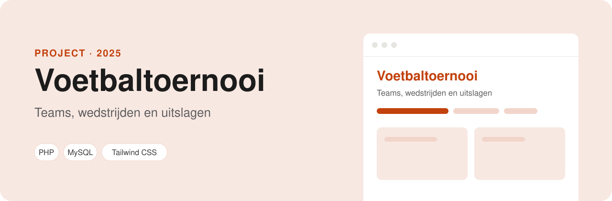

<p align="center">
  
</p>

<p align="center">
  
  
  
</p>

# Voetbaltoernooi

Een webapp om een voetbaltoernooi te regelen. Teams schrijven zich in met hun spelers, de organisatie plant de wedstrijden en vult de uitslagen in. Een admin en een gewone gebruiker zien elk hun eigen deel van de site.

## Functies

**Voor iedereen**
- Een homepage met de **ranglijst** (3 punten voor winst, 1 voor gelijkspel, daarna doelsaldo), de komende wedstrijden en de laatste uitslagen.

**Voor teams**
- Een team inschrijven met teamnaam, inloggegevens en spelers (`register.php`). Gebruiker, team en spelers worden in één transactie opgeslagen: lukt één stap niet, dan wordt niets bewaard.
- Een eigen dashboard met je spelers, je volgende wedstrijd, je wedstrijden en de ranglijst met jouw team gemarkeerd.
- Teams en hun spelers bekijken (`view_teams.php`).

**Voor de admin**
- Een beheerdersdashboard (`admin_.php`). De admin-pagina's zijn afgeschermd: wie geen admin is, gaat terug naar het inlogscherm.
- Wedstrijden plannen tussen twee teams op een datum (`plan_matches.php`). Een team kan niet tegen zichzelf spelen.
- Uitslagen invoeren (`enter_results.php`).

Na het inloggen stuurt de site je op basis van je rol naar het juiste dashboard. Wachtwoorden worden versleuteld opgeslagen met `password_hash`.

## Zelf draaien

Je hebt alleen PHP nodig (bijvoorbeeld XAMPP); een database hoef je niet in te stellen. De site gebruikt **SQLite**: bij het eerste bezoek maakt hij zelf `private/database.sqlite` aan, met de voorbeelddata uit `private/database.sql`.

1. Clone het project in de map van je webserver:
   ```bash
   git clone https://github.com/ParisAngelopoulos/Voetbaltoernooi.git
   ```
2. Ga naar http://localhost/Voetbaltoernooi en log in.

Wil je opnieuw beginnen met alleen de voorbeelddata? Verwijder dan `private/database.sqlite`.

### Testaccounts

In de database staan zes teams met elk vijf spelers, negen gespeelde wedstrijden met uitslag en drie geplande wedstrijden.

| Rol | Gebruikersnaam | Wachtwoord |
| --- | --- | --- |
| Admin | `admin` | `admin123` |
| Team FC Veenendaal | `fcveenendaal` | `welkom123` |
| Team Ede United | `edeunited` | `welkom123` |
| Team Rhenen Rangers | `rhenen` | `welkom123` |

De andere teams (`wolves`, `barneveld`, `stars`) hebben ook het wachtwoord `welkom123`.

## Database

De tabellen en voorbeelddata staan in `private/database.sql` (de map `private/` is niet via het web te openen).

| Tabel | Wat erin staat |
| --- | --- |
| `users` | Accounts, met rol `admin` of `user` |
| `teams` | Teams, gekoppeld aan het account dat ze heeft ingeschreven |
| `players` | Spelers per team |
| `matches` | Wedstrijden: twee teams, een datum en de uitslag |

---

Gemaakt door **Paris Angelopoulos**, web developer in opleiding · [GitHub](https://github.com/ParisAngelopoulos) · [parisangelopoulos@gmail.com](mailto:parisangelopoulos@gmail.com)
